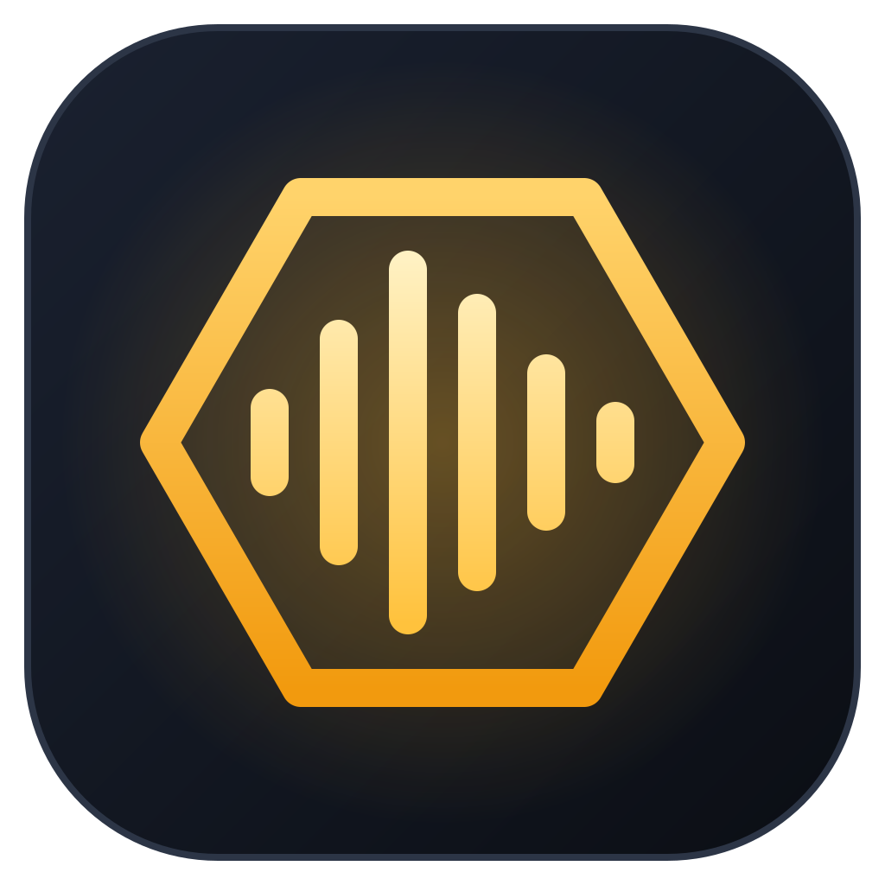
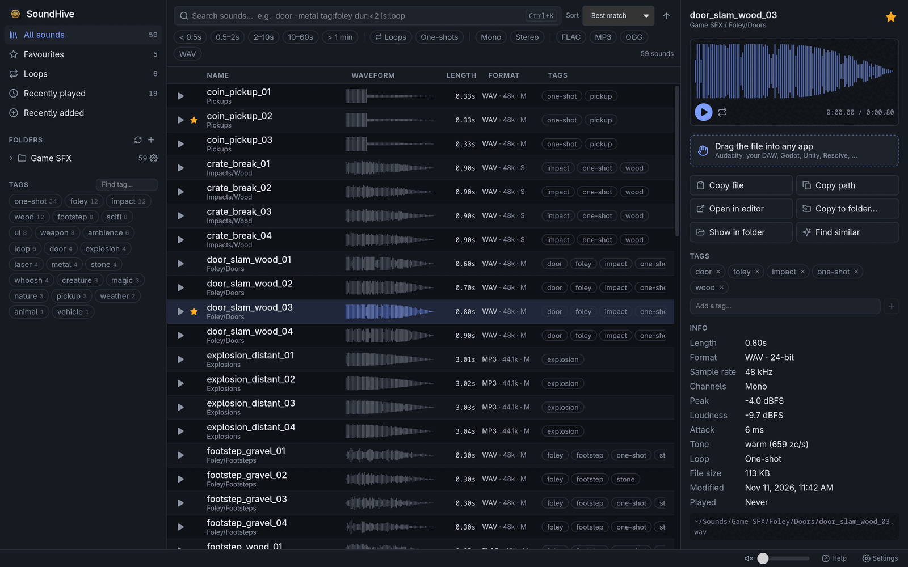
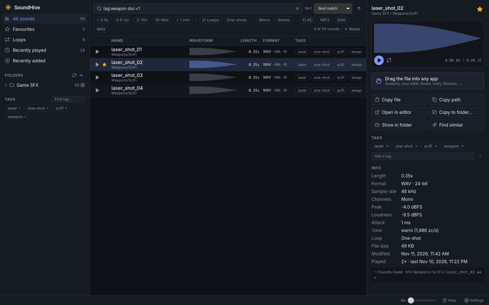
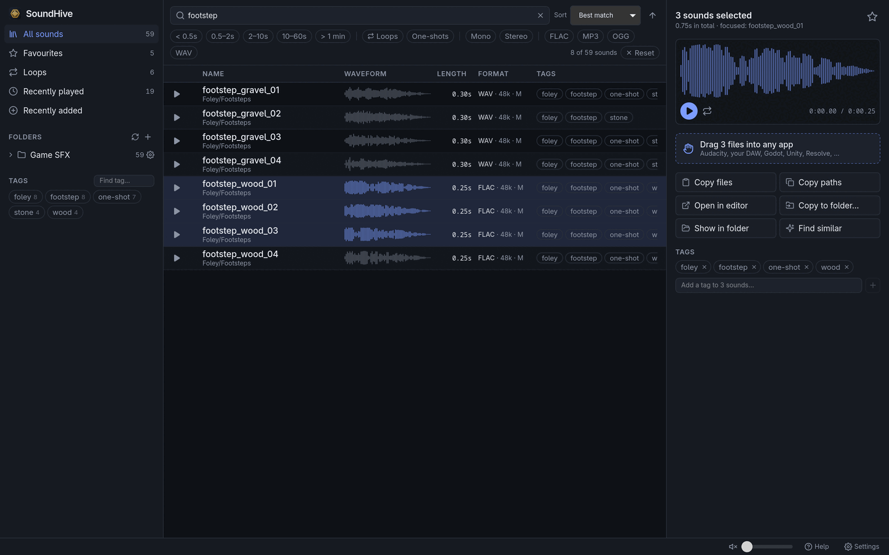
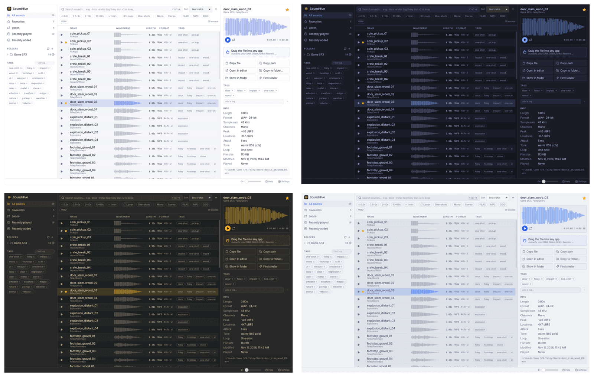

<p align="center">
  
</p>

<h1 align="center">SoundHive</h1>

<p align="center">
  <b>Find the right sound in seconds.</b><br>
  A blazing fast browser for big sound effect libraries – search, audition, tag and drag sounds straight into your game or video project.
</p>

<p align="center">
  <a href="https://github.com/BorisBrock/SoundHive/releases/latest"></a>
  <a href="https://github.com/BorisBrock/SoundHive/actions/workflows/ci.yml"></a>
  <a href="https://aur.archlinux.org/packages/soundhive"></a>
  
  <a href="LICENSE"></a>
</p>

<p align="center">
  
</p>

---

## 🎧 Your sounds, finally under control

You bought the bundles, downloaded the packs, recorded your own – and now there are 20,000 files
in 300 folders called `SFX_Final_v2`. Finding *that one* door slam means clicking through
folders and listening to everything.

SoundHive fixes that. Point it at your sound folders and it **finds, measures and tags every
file** in seconds. Then search like you think – `door slam -metal dur:<2` – and browse the results
with the arrow keys while every sound plays instantly. Found it? **Drag it** into Audacity, your
DAW, Unity, Godot or your video editor.

---

## ✨ Features

### ⚡ Seriously fast

Files are decoded on all CPU cores: a library of **24,000 sounds (6 GB) is analysed in about 11
seconds** and rescanned in under 0.1 s, because rescans only look at new and changed files.
Moved or renamed files keep their tags and favourites.

### ▶️ Instant playback

Native audio, no browser player. Click a row, or browse with `↑`/`↓` and every sound plays as
it is selected. Click a waveform to jump to that point, press `L` to loop.

### 🔍 Search with superpowers

Search across names, folders, tags and embedded descriptions – and narrow it down with operators:

```text
door slam -metal tag:foley ext:wav dur:<2 is:loop
```

<p align="center">
  
</p>

Filter by length, loops/one-shots, mono/stereo, file type, folder and tags with one click. Sort
by name, length, loudness, brightness, date, size or how often you played a sound.

### 🏷️ Automatic tags

SoundHive tags sounds from their file and folder names (`gunshot` → `weapon`, `footsteps` →
`footstep`, …) with keyword rules you can edit, and from the analysis: `loop`, `one-shot`,
`long`. Add your own tags to one sound or a whole selection, and rename tags everywhere at once.

### 📊 Knows every sound

Length, format, sample rate, bit depth, channels, peak and RMS level, attack time, brightness, a
waveform – and whether a sound is a **loop**: from loop points in the file, a name like `*_loop`,
or an end that flows seamlessly into the start.

### 🧲 Find similar

Found a sound that's *almost* right? Press `S` and SoundHive orders the library by how close
other sounds are in length, loudness, punch, brightness, attack and tags.

### 📤 Getting sounds out

<p align="center">
  
</p>

- **Drag** rows into Audacity, a DAW, a game engine, a video editor or a folder.
- **`Ctrl+C`** puts the *file* on the clipboard – paste it anywhere that accepts files.
- **`E`** opens the sound in Audacity (or the editor of your choice).
- **`P`** copies it into your project folder, never overwriting anything.

Your sound files are only ever read, never changed.

### 🎨 12 themes

<p align="center">
  
</p>

Plus favourites, recently played and recently added, multi-selection, and `?` for all keyboard
shortcuts.

**Supported formats:** WAV, MP3, OGG (Vorbis), FLAC, AIFF and M4A (AAC).

---

## 📦 Installation

Download the latest version from the
**[releases page](https://github.com/BorisBrock/SoundHive/releases/latest)**.

### Windows

Download and run **`SoundHive_<version>_x64-setup.exe`**. It installs for your user only, no
admin rights needed. Prefer no installation? Take **`SoundHive-<version>-windows-x64.exe`** – it
runs as is, from anywhere.

Windows SmartScreen may warn about an unknown publisher: click *More info → Run anyway*.

### Arch Linux, CachyOS, Manjaro (AUR)

Install [`soundhive`](https://aur.archlinux.org/packages/soundhive) with an AUR helper:

```bash
paru -S soundhive     # or: yay -S soundhive
```

The package is built from source, which takes a few minutes the first time.

### Ubuntu, Debian, Linux Mint, Pop!_OS

Download **`SoundHive_<version>_amd64.deb`** and install it:

```bash
sudo apt install ./SoundHive_*_amd64.deb
```

Needs Ubuntu 24.04, Debian 13 or newer.

### Any other Linux (AppImage)

Download **`SoundHive-<version>-linux-x64.AppImage`**, make it executable and run it:

```bash
chmod +x SoundHive-*-linux-x64.AppImage
./SoundHive-*-linux-x64.AppImage
```

---

## 🚀 Getting started

1. Click **`+`** next to *Folders* in the sidebar and pick the folder with your sounds.
2. Wait a few seconds while SoundHive scans it.
3. Search, browse with `↑`/`↓`, and drag what you like into your project.

The **[user guide](docs/USER_GUIDE.md)** has the full search syntax and all keyboard shortcuts.
Press `?` in the app for a quick reference.

---

## ☕ Support the project

If SoundHive finds you the perfect *whoosh*, you can buy me a coffee. Thank you!

<a href="https://www.buymeacoffee.com/borisbrock" target="_blank"></a>

---

## 🛠️ For developers

- **[Building from source](docs/BUILDING.md)** – requirements, development setup, local release
  builds, tests and benchmarks.
- **[Releasing](docs/RELEASING.md)** – how the CI/CD pipeline builds and publishes Windows, Linux
  and AUR releases.

SoundHive is built with [Tauri 2](https://v2.tauri.app), [Svelte 5](https://svelte.dev), Rust,
[Symphonia](https://github.com/pdeljanov/Symphonia) and [rodio](https://github.com/RustAudio/rodio).

---

## 📄 License

SoundHive is free and open source under the [MIT License](LICENSE).
